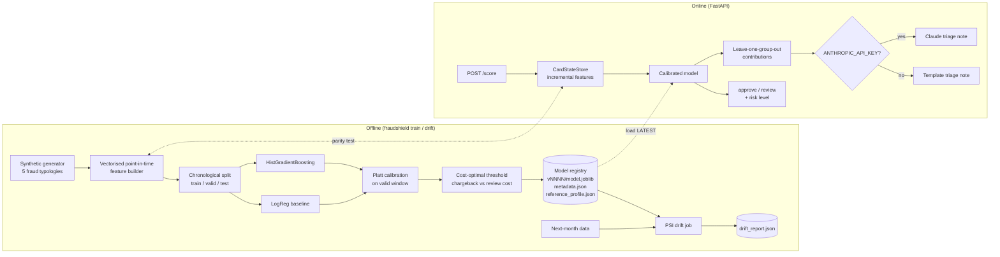

# FraudShield

**Real-time card fraud detection: point-in-time velocity features, calibrated gradient boosting, cost-optimal alerting, per-prediction explanations and PSI drift monitoring, served behind a FastAPI endpoint with ~1 ms model latency.**

[](https://github.com/krishnakm143/fraudshield-ml/actions/workflows/ci.yml)
[](https://www.python.org/)
[](LICENSE)
[](https://scikit-learn.org/)

---

> **LLM providers:** set `GROQ_API_KEY` (free tier, `openai/gpt-oss-120b`, used first) or `ANTHROPIC_API_KEY` (Claude). `LLM_PROVIDER` picks one, `LLM_OFFLINE=1` forces offline. The Claude instructions below apply to either key.

## Why this matters

A fraud model only earns its keep if it holds up in production, and most portfolio fraud projects never get that far. They train on a shuffled Kaggle CSV, report ROC-AUC on data that leaked across time, and stop at a 0.5 threshold. Fraud teams deal with problems those projects skip:

- **Leakage.** A velocity feature computed with a rolling window that includes the current or a future transaction inflates offline metrics and then falls apart in serving.
- **Training/serving skew.** Features computed in pandas for training and in hand-written code at request time slowly drift apart.
- **The threshold is a business decision.** Missing a $1,500 fraud and sending a $6 analyst review are not equal errors.
- **Analysts need reasons.** "Score 0.97" can't be actioned. "New device, 10,000 km from home, 02:14, first electronics purchase" can.
- **Fraud adapts.** Last quarter's model degrades quietly unless you watch the input distributions.

FraudShield is a compact, end-to-end, tested answer to each of these.

## Features

- **Deterministic synthetic data** (~50k transactions, 2,500 cards, 1.5% fraud) with five real typologies: card-testing bursts, geo-velocity (impossible travel), night-time high value, new merchant category and account takeover. Legitimate behaviour overlaps with each one (genuine travel, $0.99 app-store charges, phone upgrades, big-ticket purchases), and 30% of attacks are "stealthy".
- **Point-in-time feature pipeline**: 19 behavioural features plus a one-hot merchant category. Every feature uses only the card's *strictly earlier* transactions: 1h/24h velocity, small-charge bursts, implied travel speed, distance from the usual location, amount z-score against the card's history, new device/category/country.
- **One feature definition, two engines.** A vectorised offline builder (0.2 s for 50k rows) and an incremental online `CardStateStore`. A test replays the log through both and asserts they match to 1e-6.
- **Models**: a `LogisticRegression` baseline and `HistGradientBoostingClassifier`, both class-weighted for the imbalance, with a **chronological train/valid/test split**.
- **Probability calibration** (Platt scaling on a held-out window) turns class-weighted scores back into real probabilities. HGB Brier score drops from 0.0037 to 0.0029, and logistic regression from 0.0211 to 0.0042.
- **Cost-optimal threshold**: minimises *chargeback amount + fee* for missed fraud plus *review + friction* cost per alert, measured on the validation window.
- **Fraud metrics**: PR-AUC, ROC-AUC, recall @ 1% FPR, expected savings against having no model, and recall broken down by fraud pattern.
- **Explanations without SHAP**: leave-one-feature-group-out contributions against a typical legitimate transaction, scored in one vectorised call (+0.6 ms).
- **Analyst summary**: a structured triage note (risk level, headline, signals, likely pattern, action) written by Claude when `ANTHROPIC_API_KEY` is set. Otherwise a deterministic template fills the same schema, so the whole project runs offline.
- **Drift monitoring**: PSI per feature and on the model score, a structural-drift allowlist, live performance when labels are available, and a retrain recommendation.
- **Model registry**: versioned `joblib` artefacts plus `metadata.json` (metrics, threshold, calibration params, data fingerprint, periods, cost model), a reference profile and a `LATEST` pointer.
- **Serving**: FastAPI `POST /score`, `POST /score/batch`, `GET /model`, `GET /drift`, `GET /health`. The CLI provides `fraudshield generate | train | evaluate | drift | serve`.

## Architecture



## Quickstart

### Offline (no API key needed)

```bash
git clone https://github.com/krishnakm143/fraudshield-ml.git && cd fraudshield-ml
pip install -e ".[dev]"

fraudshield train            # ~4s: fits both models, calibrates, picks threshold, registers v0001
python -m fraudshield.evaluate   # prints the metrics table below
fraudshield drift            # PSI report: training reference vs shifted "next month"
fraudshield serve            # http://localhost:8000/docs
python -m pytest -q          # 20 tests, fully offline
```

The bundled data in `data/` can be regenerated byte-for-byte with `fraudshield generate`.

### With Claude analyst summaries

```bash
cp .env.example .env         # set ANTHROPIC_API_KEY=...
export $(grep -v '^#' .env | xargs)
fraudshield serve
# /score?summary=true now returns a Claude-written triage note (claude-opus-5-5);
# any API failure transparently falls back to the template.
```

### Docker

```bash
docker compose up --build api                 # model + drift report baked into the image
docker compose --profile jobs run --rm trainer   # retrain into the shared registry volume
```

## API examples

```bash
# Score one transaction (explanation on by default; add summary=true for the triage note)
curl -s -X POST "localhost:8000/score?summary=true" -H 'Content-Type: application/json' -d '{
  "card_id": "C00042", "timestamp": "2026-03-31T02:14:00", "amount": 1899.0,
  "merchant_category": "electronics", "channel": "online",
  "lat": 44.43, "lon": 26.10, "country": "RO", "device_id": "dev_unknown_1"
}'

# Batch: scored chronologically so a burst inside the batch sees its own velocity
curl -s -X POST localhost:8000/score/batch -H 'Content-Type: application/json' \
  -d '{"transactions": [ ... ], "explain": false, "commit": true}'

curl -s localhost:8000/model    # version, threshold, calibration, test metrics, data periods
curl -s localhost:8000/drift    # PSI per feature, score PSI, live performance, recommended action
```

`commit=false` scores without writing the transaction into the card's online state, which is useful for what-if checks.

## Sample output

`POST /score?summary=true` for a 02:14 online electronics order from Bucharest on a US card with an unseen device:

```json
{
  "card_id": "C00042",
  "fraud_probability": 0.979257,
  "threshold": 0.12,
  "decision": "review",
  "risk_level": "critical",
  "model_version": "v0001",
  "explanation": [
    {"feature": "merchant_category", "value": "electronics", "contribution": 0.8007, "direction": "raises risk"},
    {"feature": "hour_of_day",       "value": "02:14",       "contribution": 0.174,  "direction": "raises risk"},
    {"feature": "is_online",         "value": "yes",         "contribution": 0.1445, "direction": "raises risk"},
    {"feature": "dist_home_km_log",  "value": "10,552 km",   "contribution": 0.1331, "direction": "raises risk"},
    {"feature": "is_new_category",   "value": "yes",         "contribution": 0.0705, "direction": "raises risk"}
  ],
  "analyst_summary": {
    "risk_level": "critical",
    "headline": "Critical risk (98%) on $1,899.00 at an electronics merchant, consistent with account takeover.",
    "key_signals": ["merchant category: electronics (+0.80)", "time of day: 02:14 (+0.17)",
                    "card-not-present channel: yes (+0.14)", "distance from usual location: 10,552 km (+0.13)"],
    "likely_pattern": "account_takeover",
    "recommended_action": "Decline and block the card; contact the cardholder through a verified channel."
  },
  "summary_source": "offline-heuristic",
  "latency_ms": 5.2
}
```

## Evaluation

All numbers below come from `python -m fraudshield.evaluate` on the bundled data (49,838 transactions, 1.51% fraud). The splits are chronological: train Jan 1 to Feb 23, valid Feb 23 to Mar 13 (calibration, threshold and model selection), and **test Mar 13 to Mar 31** (9,968 transactions, 128 frauds), which is reported only and never used to tune anything. Full JSON is in [`reports/metrics.json`](reports/metrics.json).

| Metric (test window) | LogReg baseline | **HistGradientBoosting** |
|---|---:|---:|
| PR-AUC | 0.817 | **0.920** |
| ROC-AUC | 0.9914 | **0.9981** |
| Recall @ 1% FPR | 0.852 | **0.945** |
| Brier, calibrated (raw) | 0.0042 (0.0211) | **0.0029** (0.0037) |
| Cost-optimal threshold | 0.070 | 0.120 |
| Precision / recall @ threshold | 0.491 / 0.852 | **0.655 / 0.891** |
| Alert rate | 2.23% | **1.75%** |
| Fraud $ caught | 91.4% | **92.9%** |
| Expected savings vs no model | $18,384 (82.7%) | **$19,271 (86.7%)** |

Cost model: a missed fraud costs the amount plus a $20 chargeback fee, every alert costs a $6 review, and a false alert adds $4 of customer friction. You can change these with `fraudshield train --review-cost ... --friction-cost ... --chargeback-fee ...`.

**Recall by fraud pattern (HGB, test):** geo-velocity 1.00 (n=23), night high-value 1.00 (n=5), account takeover 0.90 (n=42), card testing 0.88 (n=43), new category 0.67 (n=15). Most misses are the deliberately stealthy attacks that reuse the cardholder's device and location.

**Latency** (single transaction, 1 thread): online features + calibrated model **p50 0.98 ms / p95 1.04 ms**, and with explanation **p50 1.57 ms**. The full HTTP round trip through FastAPI's TestClient measures p50 4.0 ms / p95 5.3 ms, well inside the 20 ms budget, and a test enforces that budget. Training both models takes **2.7 s**.

### Drift: training reference vs a shifted "next month"

`fraudshield drift` scores April data (16,864 transactions) with more e-commerce, holiday categories, +45% amounts and fraudsters moving to stealthier account takeovers:

| Feature | PSI | Status |
|---|---:|---|
| is_online | 0.282 | significant |
| amount_log | 0.165 | moderate |
| amount_zscore | 0.135 | moderate |
| amount_ratio_mean_log | 0.102 | moderate |
| model score | 0.130 | moderate |

The labels in that window confirm the alarm: PR-AUC falls from **0.920 to 0.897**, recall @ 1% FPR from **0.945 to 0.879** and precision at the deployed threshold from **0.655 to 0.541**. The report's recommendation is *retrain*.

## Design decisions and trade-offs

- **Chronological split.** Random splits put a card's future behaviour into training. The time split costs some optimism on the headline metric, but it matches how the model is actually used.
- **One feature definition, two implementations, plus a parity test.** A real system would use a feature store such as Feast or Redis for the online side. Here the online store is an in-process dict, but the contract (no look-ahead, identical maths through a shared `_finish` function) is the part that matters, and the test enforces it.
- **Class weights plus calibration instead of resampling.** SMOTE-style oversampling distorts temporal and velocity structure. Re-weighting keeps the data honest, and Platt scaling on a later window restores calibrated probabilities, which the cost model needs.
- **Hand-written Platt calibrator.** `CalibratedClassifierCV(cv="prefit")` changed API across scikit-learn versions. Two inspectable parameters stored in the metadata are more robust to that churn.
- **Model selection by expected savings on validation**, not by AUC. The business objective decides which model ships.
- **Leave-one-group-out explanations instead of SHAP.** They work for any model, need no extra dependency and cost one batched predict. The trade-off is that they don't satisfy SHAP's additivity guarantees, and correlated features can share credit. One-hot columns are explained as one group.
- **The LLM is used only for the analyst-facing text.** Scoring is deterministic, auditable and fast. The LLM never touches the decision, and its output schema matches the template exactly.
- **Drift reference = the validation window.** Card histories are mature there, so cold-start effects don't show up as drift. `history_count_log` is still reported but labelled *structural* and excluded from the retrain decision, because it grows by construction.
- **Single-threaded by default (`FRAUDSHIELD_THREADS=1`).** In CPU-quota containers, multi-threaded HGB showed heavy OpenMP oversubscription: a 2 s fit took 35 s. Single-row scoring gains nothing from threads.

## Project structure

```
fraudshield-ml/
├── src/fraudshield/
│   ├── data.py        # deterministic generator, 5 fraud typologies, next-month shift
│   ├── features.py    # point-in-time features: vectorised builder + online CardStateStore
│   ├── model.py       # candidate estimators, Platt calibrator, FraudModel + contributions
│   ├── metrics.py     # PR-AUC, recall@FPR, cost model, threshold search
│   ├── train.py       # time split -> fit -> calibrate -> threshold -> select -> register
│   ├── registry.py    # versioned joblib + metadata.json + LATEST
│   ├── drift.py       # PSI profiles and report
│   ├── monitor.py     # drift job (features for a new period with history context)
│   ├── explain.py     # contribution formatting, analyst summary (Claude / template)
│   ├── service.py     # scoring service shared by API and CLI
│   ├── api.py         # FastAPI app
│   ├── cli.py         # `fraudshield` entry point
│   ├── evaluate.py    # `python -m fraudshield.evaluate`
│   └── llm.py         # shared Claude client with offline fallback
├── tests/             # 20 tests: data, features (parity, no-leakage), model, API, CLI
├── data/              # transactions.csv.gz, next_month.csv.gz, sample_transactions.csv
├── reports/           # metrics.json, drift_report.json
├── Dockerfile  docker-compose.yml  Makefile  pyproject.toml
└── .github/workflows/ci.yml
```

## Roadmap

- Redis-backed `CardStateStore` with TTL eviction, so state is shared across API replicas.
- Graph features (shared devices and merchants across cards) to catch fraud rings.
- Champion/challenger shadow scoring and automatic promotion on validated savings.
- Delayed-label simulation: chargebacks arrive 30 to 60 days late, so live performance monitoring has to work on partial labels.
- Scheduled drift job with alerting (Prometheus metrics, Slack webhook).
- Isotonic calibration once validation windows are large enough, plus calibration drift tracking.

## License

MIT, see [LICENSE](LICENSE). The data is fully synthetic and contains no real personal or card data.
